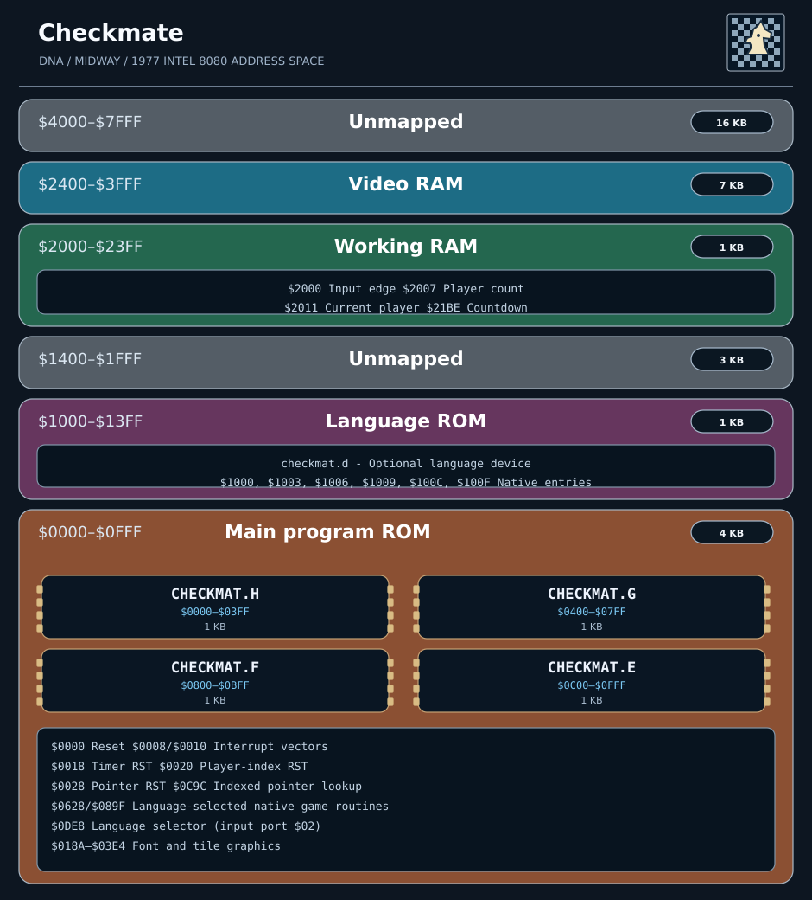

# Checkmate

Checkmate was developed by Dave Nutting Associates (DNA) and released by Midway in 1977. It runs on Midway Intel 8080 arcade hardware. This project maintains the native Intel 8080 disassembly, original program ROMs, graphics and sound data, hardware documentation, and research into DNA's early game engines.


Checkmate uses native 8080 game routines and shared RST services. Its language selector uses indexed 16-bit native entry points, including entries in the optional language ROM. The documented resident ROM does not use the indexed game-bytecode dispatch loop identified in DNA's Boot Hill and baseball games.

| | |
| --- | --- |
| [Native execution](#native-program-architecture) | Reset, interrupts, shared services and two language-selected native entry paths. |
| [Graphics and text](#graphics-and-text) | ROM font, tile data and language-specific display messages. |
| [Sound](#sound) | Native sound and timing routines. |
| [RAM and I/O](#ram-and-io) | Input sampling, countdowns, player state and display memory. |

## Project layout

`src/checkmate.asm`  
Annotated native Intel 8080 disassembly, original game data and graphics.

`tools/zmac`, `tools/zmac.exe`  
Bundled zmac v1.3 assemblers for Linux and Windows.

`build/`  
Untracked assembled image, listing and split 1 KB ROM devices.

`roms/original/checkmat.zip`  
Original reference ROM set. Never modified by the build.

`roms/checkmat.zip`  
Untracked MAME-compatible ROM set produced by the native build.

`build.sh`, `build.bat`  
Native assembly, ROM splitting, SHA-1 comparison and packaging.

`docs/`  
Technical notes, memory map, ROM research and original service documentation.

`images/`  
Game images and memory map.

## Build

Linux:

```sh
./build.sh
```

Windows:

```bat
build.bat
```

Both scripts assemble `src/checkmate.asm` directly using zmac v1.3, split the 4 KB image into four 1 KB devices, compare each device's SHA-1 with the original and package `roms/checkmat.zip`. Native build artifacts remain in untracked `build/`. No Python code participates in the build.

MAME:

```sh
mame checkmat -rompath roms -window -skip_gameinfo
```

## ROM organization

Four 1 KB devices hold the 4 KB resident program; the additional language ROM `checkmat.d` occupies the optional `$1000–$13FF` region and is absent from the preserved four-device reference set.

| ROM | CPU address |
| --- | --- |
| `checkmat.h` | `$0000–$03FF` |
| `checkmat.g` | `$0400–$07FF` |
| `checkmat.f` | `$0800–$0BFF` |
| `checkmat.e` | `$0C00–$0FFF` |
| `checkmat.d` (optional language device) | `$1000–$13FF` |



The opening ROM bytes contain reset and interrupt vectors. Working RAM, input/output services and bitmap video memory are addressed by the native 8080 routines.

## RAM and I/O

| Address | Use |
| --- | --- |
| `$2000–$2001` | Coin-edge sample and detected edge state |
| `$2003` | Countdown sampled by interrupt service |
| `$2007` | Player count |
| `$2011` | Current player index for indexed lookup |
| `$21BE` | Countdown used by `RST $18` wait service |
| `$2000–$23FF` | Working RAM region |
| `$2400–$3FFF` | Bitmap display RAM region |

Hardware ranges are documented alongside the board research in [memory-map details](docs/memory-map.md).

## Native program architecture

The reset entry is at `$0000`; native interrupt routines begin at `$0008` and `$0010`. Three reusable native services are invoked with Intel 8080 RST instructions:

| Service | Target | Function |
| --- | --- | --- |
| `RST $18` | `$0D7D` | Wait on game countdown |
| `RST $20` | `$0CA8` | Advance or wrap player index |
| `RST $28` | `$0C99` | Select indexed 16-bit pointer |

The common pointer helper at `$0C9C` reads a little-endian native address from a table. Language selection at `$0DE8` selects between native paths beginning at `$0628` and `$089F` or addresses in the optional language device. This is a native service and language-selection architecture, rather than the game-command interpreter found in other DNA titles.

See [Checkmate native services and language dispatch](docs/checkmate-hard-re-20261031.md) for the full trace.

## Graphics and text

The ROM contains individually labeled 8×10 font glyphs and game drawing tiles, with their raster bytes commented inline. The graphics block starts at `$0197`, following ROM-test data at `$018A`. An additional set of game drawing shapes begins at `$04AB`. English player and game messages begin with `GAME_TEXT_PLAYER` at `$0E54` and have individual names. Player-number text pointers at `$0F01`, round-result text pointers at `$0F18`, graphics pointers and character records, animation selectors, and player work-RAM addresses are defined as separate typed records.

## Sound

Native interrupt and game services coordinate counters and hardware output ports. The original [logic and sound documentation](docs/Checkmate_Logic_and_Sound_(0615-00900_Ver_A_Dec_8_1977).pdf) is retained for further signal-level analysis.

## References

- [Checkmate native services and language dispatch](docs/checkmate-hard-re-20261031.md)
- [Framework comparison](docs/framework-lineage.md)
- [Checkmate wiring diagram](docs/Checkmate_Wiring_Diagram_(1-1-1977).pdf)
- [MAME Midway Intel 8080 driver](https://github.com/mamedev/mame/blob/master/src/mame/midway/8080bw.cpp)
