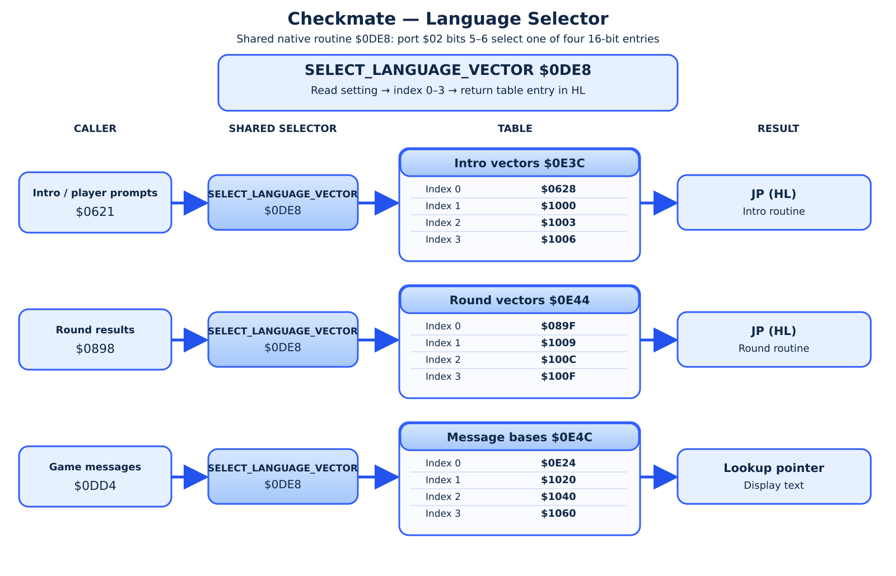

# Checkmate

Checkmate was developed by Dave Nutting Associates (DNA) and released by Midway in 1977. Jay Fenton programmed the arcade game; Dave Nutting is also credited with design and programming. 


Checkmate runs native Intel 8080 game routines with reusable RST services for timing, player indexing and table lookups. A language selector reads the cabinet's language setting, retrieves the address of a native display routine and transfers execution to it. English routines reside in the main ROM; the selection tables also contain addresses in the additional language ROM.

| | |
| --- | --- |
| [Native execution](#native-program-architecture) | Reset, interrupts, shared services and two language-selected native entry paths. |
| [Graphics and text](#graphics-and-text) | ROM font, tile data and language-specific display messages. |
| [Sound](#sound) | Native sound and timing routines. |
| [RAM and I/O](#ram-and-io) | Input sampling, countdowns, player state and display memory. |

## Project layout

`src/checkmate.asm`  
8080 disassembly

`tools/zmac`, `tools/zmac.exe`  
zmac v1.3 assemblers for Linux and Windows.

`build/`  
assembled image, listing and split 1 KB ROM devices.

`roms/original/checkmat.zip`  
MAME ROM set

`roms/checkmat.zip`  
ROM set produced by the build.

`build.sh`, `build.bat`  
build scripts.

`docs/`  
Technical notes, game documentation.

`images/`  
images and memory map.

## Build

Linux:

```sh
./build.sh
```

Windows:

```bat
build.bat
```

Both scripts assemble `src/checkmate.asm` using zmac v1.3, split the 4 KB image into four 1 KB devices, compare each device's SHA-1 with the original and package `roms/checkmat.zip`.

MAME:

```sh
mame checkmat -rompath roms -window -skip_gameinfo
```

## ROM organization

Four 1 KB devices hold the 4 KB resident program; the additional language ROM `checkmat.d` occupies the optional `$1000–$13FF` region and is absent from the preserved four-device reference set.

| ROM | CPU address |
| --- | --- |
| `checkmat.h` | `$0000–$03FF` |
| `checkmat.g` | `$0400–$07FF` |
| `checkmat.f` | `$0800–$0BFF` |
| `checkmat.e` | `$0C00–$0FFF` |
| `checkmat.d` (optional language device) | `$1000–$13FF` |


The opening ROM bytes contain reset and interrupt vectors. Working RAM, input/output services and bitmap video memory are addressed by the native 8080 routines.

## RAM and I/O

| Address | Use |
| --- | --- |
| `$2000–$2001` | Coin-edge sample and detected edge state |
| `$2003` | Countdown sampled by interrupt service |
| `$2007` | Player count |
| `$2011` | Current player index for indexed lookup |
| `$21BE` | Countdown used by `RST $18` wait service |
| `$2000–$23FF` | Working RAM region |
| `$2400–$3FFF` | Bitmap display RAM region |

Hardware ranges are documented alongside the board research in [memory-map details](docs/memory-map.md).

## Architecture

The reset entry is at `$0000`; native interrupt routines begin at `$0008` and `$0010`. Three reusable native services are invoked with Intel 8080 RST instructions:

| Service | Target | Function |
| --- | --- | --- |
| `RST $18` | `$0D7D` | Wait on game countdown |
| `RST $20` | `$0CA8` | Advance or wrap player index |
| `RST $28` | `$0C99` | Select indexed 16-bit pointer |

The pointer helper at `$0C9C` reads a 16-bit address from a table. The shared language selector at `$0DE8` reads two bits of the cabinet language setting from input port `$02`. Three callers use it: the intro at `$0621` selects a routine from `$0E3C`; round-result presentation at `$0898` selects a routine from `$0E44`; and the message helper at `$0DD4` selects a language-specific text-address base from `$0E4C`. The first two callers use `JP (HL)` to execute native code; the third uses the address to find the text to display. See [native program architecture](docs/checkmate-hard-re-20261031.md).

### Language selector and interpreter



The shared selector at `$0DE8` reads language bits 5–6 of input port `$02` and selects one of four 16-bit table entries. The **caller supplies the table**:

| Caller | Table | Action |
| --- | --- | --- |
| Intro / player prompts `$0621` | `$0E3C` | Jump to a native intro routine |
| Round-result display `$0898` | `$0E44` | Jump to a native round-result routine |
| Message selection `$0DD4` | `$0E4C` | Use the selected message-table base to find display text |

**Native selector versus interpreter**

| Checkmate selector | Desert Gun command interpreter |
| --- | --- |
| Called for a specific game operation | Executes an ongoing command loop |
| Reads cabinet language bits | Fetches the next script command |
| Selects a native code address or message-table base | Decodes the command and finds its native handler |
| Jumps to the routine or returns a data pointer | Executes the handler and advances through the script |

A `DW` assembly *word* is a 16-bit stored value, commonly an address. 

An interpreted command *word* is an encoded instruction in a game script, whose execution is driven by the interpreter. 

Both may involve native routine address tables; only the interpreter fetches and dispatches a continuing script stream.

## Graphics and text

The ROM contains individually labeled 8×10 font glyphs and game drawing tiles, with their raster bytes commented inline. The graphics block starts at `$0197`, following ROM-test data at `$018A`. 

An additional set of game drawing shapes begins at `$04AB`. 

English player and game messages begin with `GAME_TEXT_PLAYER` at `$0E54`.

## Sound

Native interrupt and game services coordinate counters and hardware output ports. The original [logic and sound documentation](docs/Checkmate_Logic_and_Sound_(0615-00900_Ver_A_Dec_8_1977).pdf).


## References

- [Checkmate wiring diagram](docs/Checkmate_Wiring_Diagram_(1-1-1977).pdf)
- [MAME Midway Intel 8080 driver](https://github.com/mamedev/mame/blob/master/src/mame/midway/8080bw.cpp)
