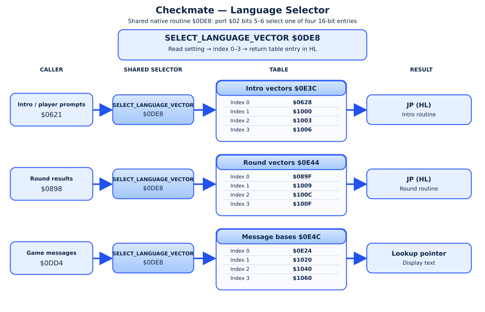

# Checkmate native program architecture

Checkmate (1977), developed by Dave Nutting Associates for Midway, uses native Intel 8080 routines for game control, player state, graphics and messages. Its four resident 1 KB ROM devices form a 4 KB program at `$0000–$0FFF`.

## Shared native services

Checkmate uses the 8080's single-byte `RST` calls to reach three common services:

| Call | Native entry | Purpose |
| --- | --- | --- |
| `RST $18` | `$0D7D` | Wait on a countdown while servicing game frames |
| `RST $20` | `$0CA8` | Advance or wrap the player index |
| `RST $28` | `$0C99` | Look up the current player's 16-bit table entry |

The lookup helper at `$0C9C` takes an index and table address, reads a little-endian 16-bit value, and returns that value in `HL`. The caller uses the value as a pointer or code entry address.

## Language selection

The shared selector at `$0DE8` reads input port `$02`, extracts language-setting bits 5–6, and indexes the four 16-bit entries in the table supplied by its caller. The indexed-word helper at `$0C9C` returns the selected address in `HL`.

Three parts of the game call the selector:

| Caller | Table | Use |
| --- | --- | --- |
| `$0621` — intro | `$0E3C` | Select introductory/player display code; execute `JP (HL)` |
| `$0898` — round result | `$0E44` | Select round-result and scoreboard code; execute `JP (HL)` |
| `$0DD4` — message lookup | `$0E4C` | Select a language-specific message-address base, then look up the text pointer |

### Native routine tables

| Setting | Intro (`$0E3C`) | Round (`$0E44`) | Message base (`$0E4C`) |
| --- | --- | --- | --- |
| 0 — English | `$0628` | `$089F` | `$0E24` |
| 1 | `$1000` | `$1009` | `$1020` |
| 2 | `$1003` | `$100C` | `$1040` |
| 3 | `$1006` | `$100F` | `$1060` |

The English routine entries point into the four resident ROMs. The other-language entries point to the additional `checkmat.d` ROM at `$1000–$13FF`. The language-specific message-base addresses are used for data lookups rather than jumps.

### Selector and interpreter

| Native selector — Checkmate | Command interpreter — Desert Gun |
| --- | --- |
| Called when a particular game operation needs one of several routines | Runs a command-processing loop |
| Reads the cabinet language setting | Fetches the next encoded command from a game script |
| Selects a native 16-bit address from a table | Decodes a command and selects its native handler |
| Jumps to an intro or round-result routine, or returns a text pointer | Executes the handler and advances through the command stream |
| Table entries are native code addresses or text-table bases | Script words are encoded commands interpreted by the engine |

A `DW` in Checkmate's assembly defines a 16-bit value, often a pointer. A command *word* in an interpreter is part of the encoded script and has behavior defined by the interpreter. Both systems can use native handler addresses, but only the interpreter follows an ongoing command stream.

## Display and game data

The source identifies the resident English messages beginning at `$0E54`, including player prompts, start-game instructions and round-result messages. Two pointer tables select spelled-out player numbers (`$0F01`) and round-result text (`$0F18`). Font, drawing, animation and player-state tables are labeled alongside the native routines in [the disassembly](../src/checkmate.asm).

## Development credits

Jamie Fenton (Jay Fenton at the time) identifies Checkmate among the games she programmed for Dave Nutting Associates. Arcade History additionally credits Dave Nutting with design and programming. Sources: [Fenton's gameography](https://www.fentonia.com/bio/), [Fenton's first-person interview](https://allincolorforaquarter.blogspot.com/2014/07/the-pre-history-of-night-driver-part-5.html) and [Arcade History](https://www.arcade-history.com/game/444/checkmate).

## Build

`./build.sh` assembles the source with bundled zmac v1.3, verifies all four original 1 KB device SHA-1 hashes and writes the MAME set to `roms/checkmat.zip`. The complete cleaned source passed all four SHA-1 checks in the user-reported Linux build on November 20, 2026. MAME launched with its known missing-`checkmat.d` warning.

For the ROM address layout, see the [memory map](../images/checkmate-memory-map.svg).
