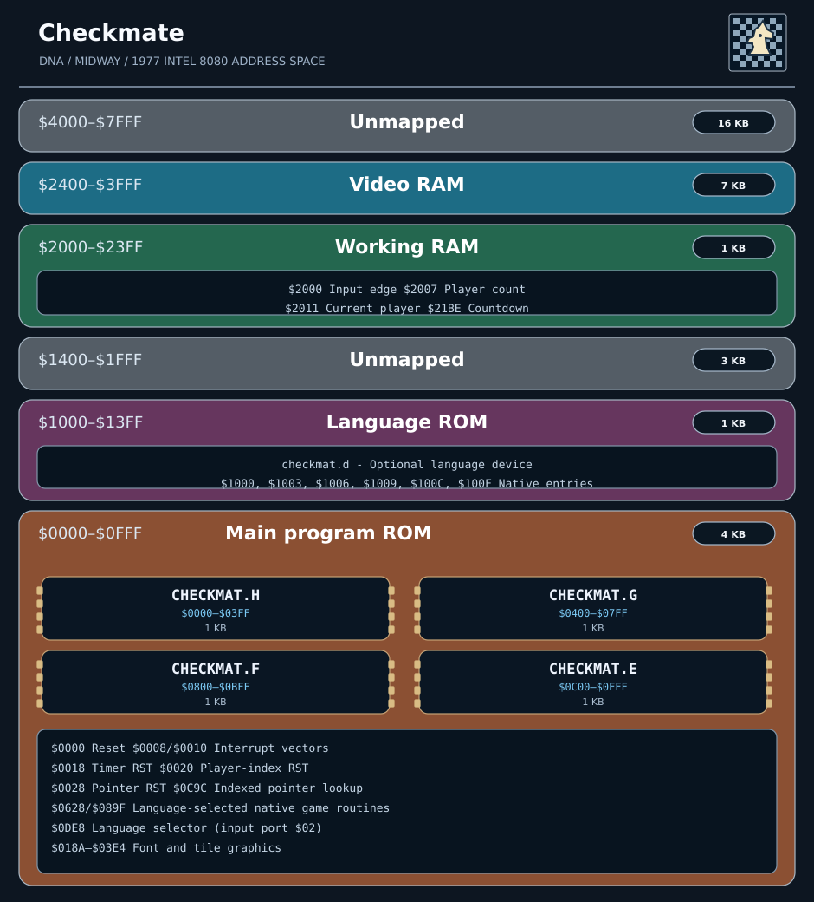

# Checkmate Intel 8080 memory map

Four 1 KB original resident ROM devices occupy $0000–$0FFF. The optional language ROM `checkmat.d` is mapped at $1000–$13FF in the documented language-selection system. The working and video RAM divisions follow the disassembly; board wiring remains the authority for address mirrors and decoding.

| Address | Device or area | Function |
| --- | --- | --- |
| $0000–$03FF | checkmat.h | Reset and IRQ entries, game code, initial glyph tables |
| $0400–$07FF | checkmat.g | Native game/display routines, language-selected entry at $0628 |
| $0800–$0BFF | checkmat.f | Native game routines, English-language round code at $089F |
| $0C00–$0FFF | checkmat.e | Shared RST services, indexed pointer lookup and messages |
| $1000–$13FF | checkmat.d, optional | Additional language entry points, not present in the reference ROM set |
| $1400–$1FFF | No resident ROM | Consult board schematic for decoding |
| $2000–$23FF | Working RAM | Timers, input edge state, player index, game state |
| $2400–$3FFF | Display RAM | Bitmap framebuffer |
| $4000–$7FFF | Upper address space | Board decode and mirrors require direct schematic tracing |

## Verified program regions

- $0000: reset entry; $0008 and $0010: interrupt entries.
- $0018, $0020 and $0028: native RST service vectors.
- $0628 and $089F: language-selected native routines.
- $0C9C: indexed 16-bit table lookup service.
- $0DE8: language selector, driven by input port $02 bits 5–6.
- $1000, $1003, $1006, $1009, $100C and $100F: language-specific native destinations in the optional ROM.

The ROM bank SHA-1 values used by `build.sh` and `build.bat` match the original inventory:

| ROM | SHA-1 |
| --- | --- |
| checkmat.h | f758599d6393398a6a8e6e7399dc1a3862604f65 |
| checkmat.g | 484ff9bfb95166ba09f34c753a7908a73de3cc7d |
| checkmat.f | 39e0cf502735819a7e1d933e3686945fcfae21af |
| checkmat.e | 453f95dd31968d439339c41e625481170437eb0f |

Reference: [native service and language-dispatch tracing](checkmate-hard-re-20261031.md).
